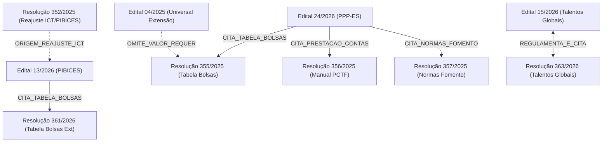

# Análise de Referências Cruzadas e Remissões Normativas no Corpus

**Data de Elaboração**: 01/10/2026  
**Finalidade**: Servir de contexto estruturado e benchmark para testes de recuperação multi-hop em experimentos de **GraphRAG**.  
**Corpus Analisado**: 12 documentos institucionais da FAPES persistidos em [`corpus_md/`](../corpus_md/).

---

## 1. Visão Geral e Relevância para GraphRAG

Em corpora regulatórios e jurídicos, editais e resoluções frequentemente utilizam **técnica legislativa remissiva**: em vez de duplicar tabelas de valores, regras contábeis e sanções, o documento emissor apenas cita a norma de regência.

### O Problema do RAG Vetorial Tradicional (Dense Retrieval)
Um sistema de busca puramente vetorial indexa fragmentos de texto (chunks) isolados. Quando submetido a perguntas como:
> *"Qual o valor mensal da bolsa de Apoio Técnico Nível Superior (AT-NS) permitida pelo Edital PPP-ES (24/2026)?"*

O RAG vetorial recupera o trecho do Edital 24/2026 que autoriza a concessão de bolsa AT-NS. Porém, **o valor financeiro (`R$ 1.900,00`) não existe naquele documento**. O modelo de linguagem (LLM) inevitavelmente alucina ou responde que a informação não foi informada.

### A Solução GraphRAG (Knowledge Graph & Multi-Hop)
Ao modelar o corpus como um **Grafo de Conhecimento**:
- O nó `Edital 24/2026` possui a aresta `[CITA_TABELA_BOLSAS]` conectando-o ao nó `Resolução 355/2025`.
- O motor de inferência GraphRAG faz a travessia (*hop*), localiza a entidade `Bolsa AT-NS` com a propriedade `valor: R$ 1.900,00` na Resolução 355/2025 e responde à pergunta com precisão determinística.

---

## 2. Grafo de Conectividade do Corpus

---

## 3. Matriz de Classificação: Citação vs. Reprodução

| Relação entre Arquivos | Conteúdo Reproduzido no Edital? | Necessita Travessia no Grafo (Multi-Hop)? | Informação Crítica Ausente na Origem |
|---|---|---|---|
| **Edital 24/2026 $\rightarrow$ Resolução 355/2025** | ❌ **NÃO** | **SIM (Obrigatório)** | Valor da bolsa AT-NS (`R$ 1.900,00`) |
| **Edital 04/2025 $\rightarrow$ Resolução 355/2025** | ❌ **NÃO** | **SIM (Obrigatório)** | Valores das bolsas EXT-E (`R$ 800,00`) e EXT-F (`R$ 450,00`) |
| **Edital 24/2026 $\rightarrow$ Resolução 356/2025** | ❌ **NÃO** | **SIM (Obrigatório)** | Regras de comprovação fiscal e manual de prestação de contas |
| **Edital 24/2026 $\rightarrow$ Resolução 357/2025** | ❌ **NÃO** | **SIM (Obrigatório)** | Normas gerais de repasse, rescisão e sanções |
| **Edital 15/2026 $\leftrightarrow$ Resolução 363/2026** | ⚠️ **PARCIAL** | **SIM (Para deveres/parceria)** | Acordo SEGER/Trajetórias e penalidades institucionais |
| **Edital 13/2026 $\leftrightarrow$ Resolução 352/2025** | ✅ **SIM** | **NÃO (Auto-suficiente)** | Valor da bolsa ICT já consta no edital (`R$ 900,00`) |

---

## 4. Detalhamento dos Casos de Análise

### Caso 1: Edital 24/2026 $\rightarrow$ Resolução 355/2025 (Tabela de Bolsas AT-NS)
- **Arquivo de Origem**: [`corpus_md/edital-024-2026.md`](file:///Users/gabrielcordeiro/Repos/graphrag-experiment/corpus_md/edital-024-2026.md) (Linha 2517 e 3959)
- **Arquivo de Destino**: [`corpus_md/resolucao-355-2025.md`](file:///Users/gabrielcordeiro/Repos/graphrag-experiment/corpus_md/resolucao-355-2025.md)
- **Análise de Conteúdo**:
  - O Edital 24/2026 autoriza expressamente a previsão de até 1 bolsa de **Apoio Técnico Nível Superior (AT-NS)** por até 24 meses.
  - O Edital **NÃO estampa o valor da bolsa**. Apenas faz remissão:  
    `"324/2023 e 355/2025 – Tabela de Valores de Bolsas e Auxílios"`
  - Na Resolução 355/2025 encontra-se a tabela financeira:  
    `|Apoio Técnico|Superior|AT-NS|1.650,00|1.900,00|13%|`
- **Diagnóstico**: **Citação meramente remissiva**. O leitor ou agente é **100% obrigado** a consultar a Resolução 355/2025 para obter o valor de **R$ 1.900,00**.

---

### Caso 2: Edital 04/2025 $\rightarrow$ Resolução 355/2025 (Bolsas EXT-E e EXT-F)
- **Arquivo de Origem**: [`corpus_md/edital-004-2025.md`](file:///Users/gabrielcordeiro/Repos/graphrag-experiment/corpus_md/edital-004-2025.md) (Linha 11 e 180)
- **Arquivo de Destino**: [`corpus_md/resolucao-355-2025.md`](file:///Users/gabrielcordeiro/Repos/graphrag-experiment/corpus_md/resolucao-355-2025.md)
- **Análise de Conteúdo**:
  - O Edital 04/2025 (Universal de Extensão III) impõe como requisito obrigatório a previsão e manutenção de bolsista nas modalidades **EXT-E** ou **EXT-F** pelo prazo mínimo de 22 meses.
  - O texto do edital **não apresenta a remuneração mensal** dessas categorias de bolsa.
  - A Resolução 355/2025 traz os valores em vigor:
    - Extensão Tecnológica Nível E (`EXT-E`): **R$ 800,00**
    - Extensão Tecnológica Nível F (`EXT-F`): **R$ 450,00**
- **Diagnóstico**: **Citação remissiva**. Sem navegar até a Resolução 355/2025, é impossível calcular o montante a ser reservado no orçamento da proposta.

---

### Caso 3: Edital 24/2026 $\rightarrow$ Resolução 356/2025 (Prestação de Contas)
- **Arquivo de Origem**: [`corpus_md/edital-024-2026.md`](file:///Users/gabrielcordeiro/Repos/graphrag-experiment/corpus_md/edital-024-2026.md) (Linhas 1655, 1899, 2232, 2509 e 3954)
- **Arquivo de Destino**: [`corpus_md/resolucao-356-2025.md`](file:///Users/gabrielcordeiro/Repos/graphrag-experiment/corpus_md/resolucao-356-2025.md)
- **Análise de Conteúdo**:
  - O Edital 24/2026 exige que a execução financeira obedeça ao *"Manual de Utilização de Recursos Financeiros e Prestação de Contas da Fapes/Funcitec (Resolução CCAF nº 313/2022 e 356/2025)"*.
  - O edital lista cláusulas genéricas de obrigações, mas **não reproduz** nenhuma das instruções práticas de contabilidade e comprovação fiscal estabelecidas pela Resolução 356/2025.
- **Diagnóstico**: **Citação meramente remissiva**.

---

### Caso 4: Edital 24/2026 $\rightarrow$ Resolução 357/2025 (Normas Gerais de Fomento)
- **Arquivo de Origem**: [`corpus_md/edital-024-2026.md`](file:///Users/gabrielcordeiro/Repos/graphrag-experiment/corpus_md/edital-024-2026.md) (Linhas 1598, 2526 e 3959)
- **Arquivo de Destino**: [`corpus_md/resolucao-357-2025.md`](file:///Users/gabrielcordeiro/Repos/graphrag-experiment/corpus_md/resolucao-357-2025.md)
- **Análise de Conteúdo**:
  - O Edital 24/2026 referencia a Resolução CCAF/FAPES nº 357/2025 como marco de conformidade para liberação, repasse e prorrogação de termos de outorga.
  - A Resolução 357/2025 é um regulamento autônomo com mais de 500 linhas de dispositivos sobre sanções administrativas, penalidades de inadimplência, alteração de plano de trabalho e prestação final de contas.
- **Diagnóstico**: **Citação meramente remissiva**.

---

### Caso 5: Edital 15/2026 $\longleftrightarrow$ Resolução 363/2026 (Talentos Globais)
- **Arquivos**: [`corpus_md/edital-015-2026.md`](file:///Users/gabrielcordeiro/Repos/graphrag-experiment/corpus_md/edital-015-2026.md) e [`corpus_md/resolucao-363-2026.md`](file:///Users/gabrielcordeiro/Repos/graphrag-experiment/corpus_md/resolucao-363-2026.md)
- **Análise de Conteúdo**:
  - **O que está no Edital**: Traz os valores operacionais específicos da chamada (mensalidade de até `US$ 1.500,00` e auxílio-instalação de `US$ 1.000,00`), cronograma e critérios de pontuação da seleção.
  - **O que está unicamente na Resolução 363/2026**: A estruturação institucional do acordo internacional de cooperação técnica (parceria com o Instituto Trajetórias e SEGER), o regime formal de obrigações do bolsista perante o CCAF e os critérios de ressarcimento/penalidades por cancelamento.
- **Diagnóstico**: **Regime híbrido / reprodução parcial**. Perguntas financeiras imediatas são respondidas pelo edital; perguntas institucionais ou jurídicas sobre o programa exigem a Resolução 363/2026.

---

### Caso 6: Edital 13/2026 $\longleftrightarrow$ Resolução 352/2025 (PIBICES)
- **Arquivos**: [`corpus_md/edital-013-2026.md`](file:///Users/gabrielcordeiro/Repos/graphrag-experiment/corpus_md/edital-013-2026.md) e [`corpus_md/resolucao-352-2025.md`](file:///Users/gabrielcordeiro/Repos/graphrag-experiment/corpus_md/resolucao-352-2025.md)
- **Análise de Conteúdo**:
  - No item 7.2 do Edital 13/2026 consta explicitamente:  
    `"7.2. O valor mensal atual da bolsa de ICT é de R$ 900,00 (novecentos reais), conforme fixado na Tabela de Valores de Bolsas e Auxílios da Fapes..."`
  - Esse valor de `R$ 900,00` foi o reajuste normatizado pela Resolução 352/2025 (Anexo I, tabela de bolsas do PIBICES).
- **Diagnóstico**: **Reprodução integral do dado**. O edital transcreve o valor literalmente. Para saber o valor da bolsa, **não** há necessidade de travessia ao outro arquivo.

---

## 5. Benchmark de Perguntas para Teste de GraphRAG

As perguntas a seguir podem ser usadas diretamente para validar e contrastar um **RAG Vetorial (Baseline)** contra o **GraphRAG**:

| ID | Pergunta de Teste | Resposta Correta | Requer Multi-Hop no Grafo? | Arquivos Envolvidos |
|---|---|---|---|---|
| **Q1** | Qual o valor mensal da bolsa de Apoio Técnico Nível Superior (AT-NS) permitida pelo Edital PPP-ES 24/2026? | **R$ 1.900,00** | **SIM** (Edital não contém o valor) | `edital-024-2026.md` $\rightarrow$ `resolucao-355-2025.md` |
| **Q2** | Qual o valor das bolsas EXT-E e EXT-F exigidas no Edital Universal de Extensão (04/2025)? | **EXT-E: R$ 800,00** **EXT-F: R$ 450,00** | **SIM** (Edital não contém os valores) | `edital-004-2025.md` $\rightarrow$ `resolucao-355-2025.md` |
| **Q3** | Qual resolução da FAPES regulamenta a prestação de contas dos projetos contratados no Edital 24/2026? | **Resolução CCAF nº 313/2022 alterada pela 356/2025** | **SIM** | `edital-024-2026.md` $\rightarrow$ `resolucao-356-2025.md` |
| **Q4** | Qual entidade parceira participa da concessão de bolsas do Edital 15/2026 segundo sua resolução de regência? | **Instituto Trajetórias** (e SEGER) | **SIM** (detalhes na Resolução 363/2026) | `edital-015-2026.md` $\longleftrightarrow$ `resolucao-363-2026.md` |
| **Q5** | Qual o valor mensal da bolsa de Iniciação Científica e Tecnológica (ICT) do Edital PIBICES 13/2026? | **R$ 900,00** | **NÃO** (Consta diretamente no Edital 13, item 7.2) | `edital-013-2026.md` |
